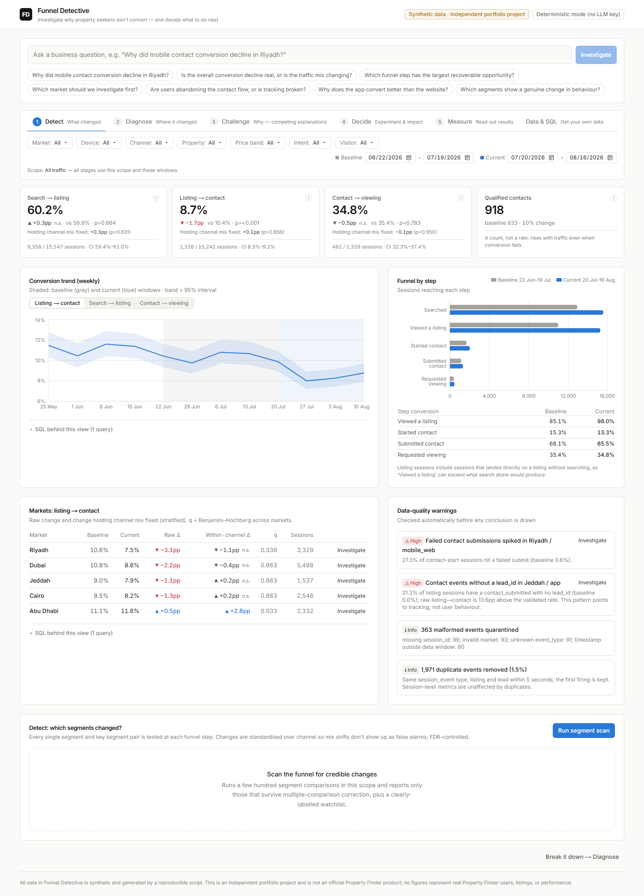

# Funnel Detective — the product decision engine

> **Synthetic data · independent portfolio project.** Every number in this repository comes from a
> reproducible generator. Nothing represents real Property Finder users, listings or performance, and this is
> not an official Property Finder product.

A product manager at a MENA real-estate marketplace sees listing-detail views going **up** while agent-contact
conversion goes **down**. A dashboard tells them *what* changed. Funnel Detective is an investigation workspace
that works out *why* it changed. It tests competing explanations against the data, says how sure it is and on
what basis, and turns the answer into a sized experiment with guardrails and a decision rule.

It is built around five connected stages:

| Stage | Question | What the product does |
|---|---|---|
| **1 Detect** | What changed? | Defined KPIs with numerators, denominators, CIs and tests; trend; funnel; market table; automatic data-quality warnings; an FDR-controlled segment scan standardised over channel |
| **2 Diagnose** | Where did it change? | Journey-step changes, segment breakdowns (raw vs within-channel), Kitagawa mix/rate decomposition, Simpson's-paradox view |
| **3 Challenge** | Why? | A natural-language question becomes a constrained plan of approved tools. A mandatory battery tests five competing explanations, each with its predicted pattern, supporting and contradicting checks, evidence level, and the data that would distinguish it |
| **4 Decide** | What should we do? | An experiment plan built from the leading explanation (hypothesis, control/treatment, primary and guardrail metrics, MDE, sample size, duration, cost, risks, decision rule), plus an editable low/base/high impact model |
| **5 Measure** | Did it work? | Readout of a logged randomised experiment, analysis of user-supplied results, or a simulation of the planned test: CI, SRM check, guardrails, and a ship/iterate/abandon decision |
| **Data & SQL** | Get your own data | Data dictionary, the approved parameterised queries and tools, a restricted read-only SQL console, and the audit trail of every investigation and SQL run |



## Quick start

Prerequisites: **Python 3.11+** (developed on 3.12) and **Node 20+** (developed on 22).

```bash
# 1. Backend
cd backend
python -m venv .venv
# Windows: .venv\Scripts\activate      macOS/Linux: source .venv/bin/activate
pip install -r requirements-dev.txt
python -m scripts.generate_data          # ~185k events, deterministic, ~7s
uvicorn app.main:app --port 8000         # http://localhost:8000/docs for the OpenAPI UI

# 2. Frontend (new terminal)
cd frontend
npm install
npm run dev                              # http://localhost:3000
```

Or with Docker, which generates the data during the image build:

```bash
docker compose up --build                # http://localhost:3000
```

**The LLM is optional.** With no key, question routing and narratives use deterministic templates, and every
analytical feature works. To enable the LLM planner and narrator, set `ANTHROPIC_API_KEY` (and optionally
`FD_LLM_MODEL`, default `claude-opus-5-5`) before starting the backend. See [.env.example](.env.example).

### Tests and evaluation

```bash
cd backend
pytest                                   # 114 tests: stats, pipeline, SQL guard, AI layer, API, scenarios
python ../eval/evaluate.py               # grades the engine against the hidden scenarios
python ../eval/evaluate.py --seeds 101-110   # robustness on held-out seeds
cd ../frontend && npm test               # 12 vitest tests
npm run build                            # type-check + production build
```

## What is in the box

```
backend/
  app/data/        schema, deterministic generator, DuckDB store (quarantine → dedupe → session table)
  app/analytics/   stats (Wilson, Newcombe, z/Fisher, Holm, BH, sample size, MDE, change point),
                   approved SQL templates, metrics (segment tables, Kitagawa, stratified tests, scans)
  app/engine/      typed schemas, approved tools, hypothesis battery, router, orchestrator
  app/llm/         provider adapter (Anthropic SDK, structured output), narrative validator
  app/experiments/ planner and results analysis      app/impact.py   impact model
  app/sqlguard.py  restricted SQL                    app/audit.py    SQLite audit trail
  tests/           pytest suite
frontend/          Next.js 15 + TypeScript + Tailwind + Recharts workspace, vitest tests
eval/              evaluate.py, ground_truth.json (never read by the app), robustness reports
docs/              architecture, data dictionary, data guide, methodology, examples, case study, demo, deploy
```

Documentation:
- [Architecture](docs/architecture.md)
- [Data dictionary](docs/data-dictionary.md)
- [Synthetic data guide](docs/synthetic-data.md)
- [Statistical methodology](docs/methodology.md)
- [Example investigations](docs/example-investigations.md) (real outputs)
- [Case study](docs/case-study.md) (Problem → Evidence → Decision → Measurement)
- [Five-minute demo script](docs/demo-script.md)
- [Deployment](docs/deployment.md)

## Design principles

1. **The model never does arithmetic.** Every number comes from deterministic Python and DuckDB SQL that the
   UI can show, with its bound parameters.
2. **Evidence and interpretation are separate objects.** An evidence statement is generated from computed
   numbers. A narrative is interpretation, and before display it must pass a validator:
   - schema-valid;
   - every point cites existing evidence;
   - every number matches a computed number;
   - no causal language without experimental evidence;
   - no support claimed for a hypothesis the checks rejected.
   On failure the product shows the deterministic narrative and the reasons it rejected the model's text.
3. **Competing explanations are mandatory.** A planner (LLM or keyword router) can add approved tools but
   cannot skip the hypothesis battery.
4. **Confidence is a rule, not a vibe.** Hypothesis status and finding confidence come from displayed rules.
   Neither is a probability, and the UI says so next to every badge.
5. **"Get your own data."** Approved, parameterised queries, a read-only SQL console with defence in depth,
   and an audit trail. The AI has no SQL access at all, only typed tools.

## Results (measured, not claimed)

Evaluation against the five planted scenarios. The engine runs exactly as the product does, on generic
questions; ground truth is only used afterwards to grade.

| Scenario | Default seed | Dev seeds 1–8 | Held-out seeds 101–110 |
|---|---|---|---|
| A Riyadh mobile-web contact-form regression (asked) | ✓ | 8/8 | 10/10 |
| A … found unprompted ("largest recoverable opportunity?") | ✓ | 8/8 | 10/10 |
| B Channel-mix shift, aggregate only (Simpson) | ✓ | 8/8 | 10/10 |
| C App advantage mostly selection | ✓ | 8/8 | 10/10 |
| D Jeddah app tracking bug, found unprompted ("abandoning or tracking?") | ✓ | 8/8 | 10/10 |
| E Dubai luxury behaviour change (asked) | ✓ | 8/8 | 10/10 |
| E … found unprompted ("which segments changed?") | ✓ | 6/8 | 9/10 |
| Negative controls with no false regression/tracking alarm | 2/2 | 8/8 | 10/10 |

The weak spot is honest: unprompted, the Dubai-luxury change is sometimes too small to survive FDR correction
across several hundred segment tests in a four-week window. When asked about it directly, the engine finds it
every time. See `eval/robustness_*.txt`.

## Assumptions and known limitations

- **Synthetic data.** The behavioural model (multipliers in `app/data/generator.py`) is a stylised assumption,
  not calibrated to any real marketplace. The scenarios were planted by the author, so the evaluation shows the
  engine recovers known structure. It does not show that it would find real-world root causes.
- **Observational analysis.** Everything except experiment readouts is associational. The release-timing check
  can show co-occurrence, not cause.
- **Session-level independence.** Tests treat sessions as independent. Repeat visitors make intervals slightly
  too narrow; user-level clustering is not modelled.
- **Fixed windows.** Comparisons are window-vs-window. There is no seasonality model, and the change-point
  method finds a single break.
- **Router coverage.** Without an LLM, questions are mapped by keyword to seven intents. Phrasings outside
  those patterns fall back to "explain a change" on the segments mentioned.
- **LLM path not exercised live in this build.** No API key was available during development. The adapter
  is written against the official SDK's documented structured-output API and tested with fake providers
  (valid, invalid, hallucinating and failing), but no call to the real API was made.
- **Single-process demo.** DuckDB is in-memory and the audit log is a local SQLite file. That's fine for a
  portfolio deployment, but it isn't a multi-tenant service and has no authentication.
- **Impact model.** Monetary value is shown only when the user enters a value per qualified contact and its
  source. Outputs are modelled estimates, never realised revenue.

## What Broke and What I Learned

These all happened while building this repository, and each fix is in the code.

1. **`python` was Python 2.7.** In this Windows environment, `python` resolved to an old MGLTools Python 2.7.
   The project uses an explicit `py -3.12` virtualenv, and the README says to create one.
2. **The naive segment scan mostly found the traffic-mix shift.** Its first version flagged "apartments",
   "buyers", "mobile web"… every broad segment, because paid-social growth lowers raw rates everywhere.
   Standardising each segment's change over acquisition channel removed those false alarms. The scan now
   flags the real within-segment changes.
3. **My stratified test was anti-conservative in small cells.** I had floored per-stratum variance to avoid
   SE = 0, and that produced a confident −36pp "finding" in a tiny commercial/mid-price cell. The fix was to
   use the pooled null-hypothesis variance per stratum, as a CMH-style test does.
4. **Threshold rules fired on tiny samples.** "Failed submits rose from 0% to 4.9%" in a segment with about 50
   contact starts made the regression hypothesis look supported for Dubai luxury. Every quality check now
   requires a significance test as well as a magnitude threshold.
5. **Failed submits are not tracking bugs.** The raw-vs-validated divergence check first blamed tracking for
   Riyadh, where the gap actually came from real form errors. The checks now separate user-facing failures
   from events missing a `lead_id`.
6. **The narrative validator caught my own templates.** My deterministic summaries said "rather than proven
   cause" and "disagree because of tracking". The causal-language guard rejected both, and I rephrased them.
   That was a useful sign the guard works on any author, not just the LLM.
7. **An all-null parquet column broke the pipeline.** In a tiny test fixture, `listing_id` was entirely null,
   so DuckDB inferred INT32 and failed on `COALESCE(listing_id, '')`. The store now casts every column to a
   declared schema and fails loudly on missing columns.
8. **A test fake matched "plan" inside "ex*plain*".** My fake LLM provider routed on a substring and fed the
   planner's JSON to the narrator. The test now matches the prompt explicitly.
9. **A clean single-seed score was luck.** The first evaluation run was 6/6. Running the same evaluation
   across 8 more seeds gave: unprompted E 1/8, unprompted A 5/8, B 7/8. Changes, each a general rule rather
   than a scenario-specific path:
   - investigate the scan's watchlist (labelled as such) with the full battery;
   - localise a broad segment to a sub-segment holding at least 60% of its loss;
   - also investigate runner-up opportunity steps;
   - rank co-supported explanations by the share of the change they account for. At seed 5 the
     within-channel decline was real, so "regression" and "mix" were both true. Mix accounted for 56% and
     should lead.

   I also changed the dataset itself: Dubai's luxury share went from 16% to 24%, because the E effect sat at
   z ≈ 3.9, below what survives FDR. I then checked on **held-out seeds 101–110** that I hadn't tuned on.
10. **The share ranking then broke a control.** A no-mechanism segment started leading with "behavioural
    change (partially supported)", because random variation had no share. Now, when the change itself isn't
    distinguishable from zero, noise is credited with all of it.
11. **Mobile overflow.** At 390px, card headers with segmented controls couldn't wrap and pushed the page wide.
    I found it with an automated `scrollWidth > innerWidth` check, not by eye.

## Licence and attribution

Portfolio project. The Property Finder name is used only to describe the intended role and context; no
Property Finder data, branding or systems are used.
